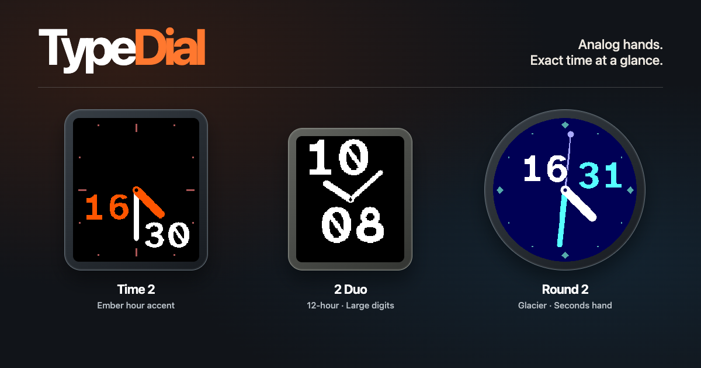

# TypeDial

<p align="center">
  
</p>

[](https://github.com/dan-hart/TypeDial/actions/workflows/test.yml)
[](LICENSE)
[](#make-it-yours)

**Analog hands show where you are in the hour. Large, upright digits give you the exact time.** Each number follows its hand using Atkinson Hyperlegible type and the reading order you choose.

[Try the design playground](#try-the-design-playground) · [Build and install](#build-and-install) · [Contribute](CONTRIBUTING.md)

## Make it yours

- **Read it your way.** Choose system, 12-hour, or 24-hour time, five Atkinson Hyperlegible variants, and a digit size up to 240 pt, with 4 pt buttons and exact entry. Move the digits toward the center or the hands’ tips, and reverse either reading axis.
- **Pick your colors.** Start with an hour- or minute-accent theme, then tune the background, hands, and dial marks using named Pebble colors and contrast guidance. On the Duo, choose the monochrome polarity.
- **Keep the dial as quiet as you like.** Optional marks include quarter hours, dots, and symbols. The optional seconds hand passes behind the glyphs without shifting the hour and minute digits.
- **Configure it offline.** Open TypeDial’s gear in the Pebble app. The live preview stays above **Save**, and settings sync locally to the watch. With seconds off, the watchface updates once a minute.

## Supported watches

| Watch | Display | Digit size | SDK target |
| --- | --- | --- | --- |
| Pebble Time 2 | 200 × 228 color | 38–240 pt | `emery` |
| Pebble 2 Duo | 144 × 168 monochrome | 27–240 pt | `flint` |
| Pebble Round 2 | 260 × 260 color | 49–240 pt | `gabbro` |

The default for new users is 60 pt. The selected size is an upper limit. TypeDial scales the digits down when needed and shows the fitted size in the preview. Above 120 pt, hands and dial marks can pass behind the digit outlines to make more room.

## Try the design playground

In a local checkout, open [`playground/index.html`](playground/index.html) directly in your browser. The standalone page needs no server or build. Try live time or sample times, compare 12-hour and 24-hour layouts, and tune digit size independently for each watch. Your browser stores the selections locally when storage is available.

The playground shares the phone preview’s renderer, fonts, palette, and settings data. It is part of the review workflow for every watchface or settings change. See the [design and architecture notes](docs/design.md).

## Build and install

Install [Pebble Tool](https://developer.repebble.com/sdk/) and SDK 4.33.1. This is the toolchain used to verify all three targets. From a checkout named `TypeDial`:

```sh
pebble sdk install 4.33.1
npm ci
pebble build
```

For a physical watch, open **Developer Connection** in the Pebble app and assign the Server IP shown there to `SERVER_IP`. See the [Pebble command-line guide](https://developer.repebble.com/guides/tools-and-resources/pebble-tool/).

```sh
pebble install --phone "$SERVER_IP" build/TypeDial.pbw
```

To try the same build in the Time 2 emulator, use `pebble install --emulator emery --vnc build/TypeDial.pbw`. Substitute `flint` or `gabbro` for the other watches.

## Contribute

Report an issue with your watch model, the TypeDial version, and the time and settings needed to reproduce it. Screenshots from the watch or playground help with layout reports. [Open an issue](https://github.com/dan-hart/TypeDial/issues/new).

Run `make test` before submitting a change. The [contribution guide](CONTRIBUTING.md) covers headless browser checks, emulator commands, and preview parity. See the [changelog](CHANGELOG.md) for user-facing changes.

## License

TypeDial’s original source is licensed under [GNU GPL version 3](LICENSE), SPDX `GPL-3.0-only`. The Atkinson Hyperlegible fonts and derived font assets are available under the SIL Open Font License 1.1. Rebble Clay is MIT-licensed. See the [third-party notices](licenses/README.md).
